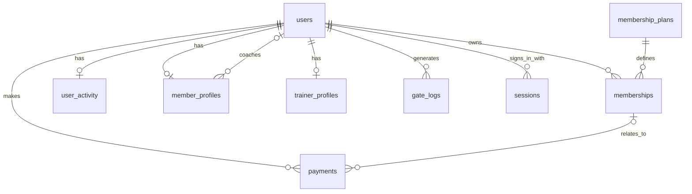

# AURA PostgreSQL DBMS guide

## Architecture

The browser renders Next.js pages and calls route handlers under `app/api`. The server checks the session cookie and role before protected operations, then uses parameterized `pg` queries in `lib/repository.ts` and `lib/db.ts`. PostgreSQL stores the data. No database credentials are sent to the browser. Passwords are bcrypt hashes; sessions use a random cookie token with only its SHA-256 digest in the database. Cookies are HTTP-only and secure in production.

## Tables and relationships

| Table | Purpose and keys |
|---|---|
| `users` | UUID primary key; identity, role, contact and password hash. Email and optional username have case-insensitive unique indexes. |
| `membership_plans` | Integer primary key; plan code, price and duration. |
| `memberships` | UUID primary key; user and plan foreign keys; purchase period and price paid. A user can have many terms. End date is exclusive. |
| `user_activity` | User ID is both primary and foreign key; current presence and session count. |
| `member_profiles` | User ID primary/foreign key; optional assigned trainer references `users`; rating and notes. |
| `trainer_profiles` | User ID primary/foreign key; specialization and approval status. |
| `gate_logs` | UUID primary key; foreign key to user; check-in/out events, source and timestamp. |
| `expenses` | UUID primary key; category, amount and date of operating costs. |
| `payments` | UUID primary key; user and optional membership foreign keys, amount, kind and months. |
| `sessions` | UUID primary key; user foreign key, unique token digest and expiry. |

`schema_migrations` is an additional bookkeeping table created by the migration runner. The canonical definitions, indexes, constraints and triggers are in `db/schema.sql`; `db/migrations/001_init.sql` is the executable initial migration.



## Normalization

Each table represents a distinct entity or relationship: plan details live once in `membership_plans`, terms reference a plan and a user, and role-specific attributes live in separate profile tables. This reduces repeated data and update anomalies and broadly follows third normal form. `price_paid` deliberately snapshots the transaction price, which may differ from a plan's later price. `user_activity` is maintained state for efficient current occupancy; gate logs retain event history.

## CRUD and joins

These are illustrative parameterized queries; `$1` and `$2` are bound values, not string interpolation. Run writes only in a disposable database. Application logic may perform additional validation and writes in a transaction.

```sql
-- Create an expense
INSERT INTO expenses (category, amount) VALUES ($1, $2);
-- Read a user's gate history
SELECT action, occurred_at FROM gate_logs WHERE user_id = $1 ORDER BY occurred_at DESC;
-- Update an existing expense
UPDATE expenses SET amount = $2 WHERE id = $1;
-- Delete an expense
DELETE FROM expenses WHERE id = $1;
-- List membership terms with their owner and plan
SELECT u.name, p.name AS plan, m.start_date, m.end_date
FROM memberships m JOIN users u ON u.id = m.user_id
JOIN membership_plans p ON p.id = m.plan_id WHERE u.id = $1;
-- List members assigned to a trainer
SELECT member.name, coach.name AS trainer
FROM member_profiles mp JOIN users member ON member.id = mp.user_id
JOIN users coach ON coach.id = mp.assigned_trainer_id WHERE coach.id = $1;
```

The repository also uses joins and a lateral query to assemble current profile and membership data. `lib/db.ts` wraps multi-step operations in `BEGIN`, `COMMIT` and `ROLLBACK`, releasing the connection in all cases. Registration, membership renewal and gate recording use transactions so related writes succeed or fail together.

## Constraints, indexes and deletes

Primary keys identify rows; foreign keys prevent orphan references. Checks cover, among other things, nonnegative amounts, valid membership periods and permitted ratings. Enum types restrict roles and statuses. Indexes support lookups such as user email, membership history, trainer assignments and recent gate events. Foreign key actions differ: dependent records often cascade on user deletion; a deleted trainer unassigns members, while a referenced plan cannot be deleted. Updated-at triggers maintain timestamps on applicable tables. See the SQL for the full set.

## Firebase comparison

Previously the browser used Firebase Google authentication and Firestore listeners, while server handlers used Firebase Admin. Now the browser uses email/password and cookie sessions; server APIs perform authorized PostgreSQL queries and joins. Refreshes are request-based. Firebase users and data are not automatically transferred; existing users need a migration and account recovery plan.

## Running locally

Follow [README.md](README.md). `npm run db:migrate` applies each unapplied SQL file in a transaction and records its filename. `npm run db:seed` creates demonstration data with the locally configured `DEMO_PASSWORD`; it is intended for a disposable database. `npm run db:reset` is destructive. `.env.local` must never be committed.

## Viva questions

1. **Why PostgreSQL?** It provides relational constraints, joins and transactions appropriate for connected gym records.
2. **What is a foreign key?** A column that must reference an existing row, such as `memberships.user_id` referencing `users.id`.
3. **What is normalization?** Organizing related facts into tables to reduce duplication and avoid update anomalies.
4. **Why use a transaction?** A membership and its payment, for example, should be recorded together or rolled back together.
5. **Why parameterized queries?** Values are sent separately from SQL syntax, reducing SQL injection risk.
6. **What does an index do?** It speeds selected lookups and ordering at the cost of storage and extra work during writes.
7. **What is a session?** A server-side record mapping a digest of a random browser cookie token to a user and expiry.
8. **Why store a password hash?** The database need not store the original password; bcrypt adds a per-password salt and deliberately expensive verification.
9. **What happens on trainer deletion?** The assigned-trainer foreign key becomes null, preserving member profiles.
10. **Why store `price_paid` separately?** Historical payment terms should remain accurate after a plan's listed price changes.
